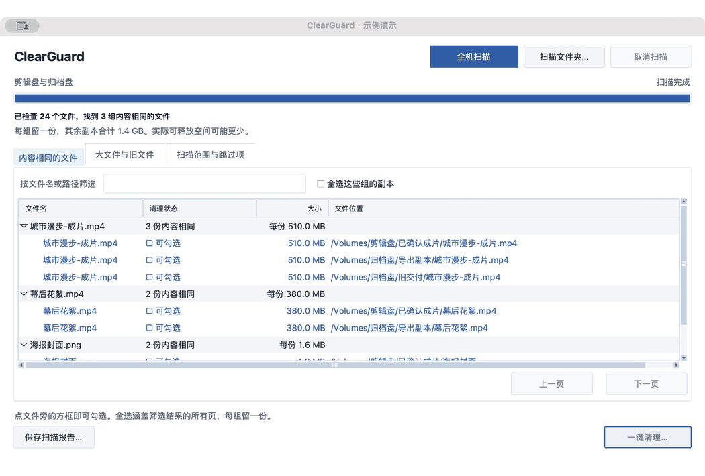

# ClearGuard

**Find exact duplicate files across local disks. Review what stays before anything moves.**

ClearGuard is an offline desktop app for **macOS and Windows**, released as source under the [MIT license](LICENSE). Scan a folder or all supported local drives, then select individual copies or all copies in the filtered results. At least one copy stays in every group. After you confirm the paths, ClearGuard rechecks them and moves the selected files to the system Trash or Recycle Bin.

ClearGuard 按实际内容查找重复文件。扫描后可以直接逐项勾选，也可以全选当前筛选结果中的副本。每组留一份，回收站操作前先核对文件路径。

[从源码运行](#快速运行) · [扫描算法](#扫描算法) · [复现性能测试](#复现性能测试) · [参与贡献](CONTRIBUTING.md)

## 下载安装

下载后可直接使用，无需单独安装 Python。

| 平台 | 下载 | 打开方式 |
|---|---|---|
| Mac（Apple 芯片） | [Apple 芯片 DMG](https://github.com/gyhchang-cell/clearguard/releases/download/v0.0.1/ClearGuard-0.0.1-macos-arm64.dmg) | 打开 DMG，把 ClearGuard 拖到「应用程序」 |
| Mac（Intel 芯片） | [Intel DMG](https://github.com/gyhchang-cell/clearguard/releases/download/v0.0.1/ClearGuard-0.0.1-macos-x86_64.dmg) | 打开 DMG，把 ClearGuard 拖到「应用程序」 |
| Windows x64 | [安装程序](https://github.com/gyhchang-cell/clearguard/releases/download/v0.0.1/ClearGuard-0.0.1-windows-x64-setup.exe) · [免安装 ZIP](https://github.com/gyhchang-cell/clearguard/releases/download/v0.0.1/ClearGuard-0.0.1-windows-x64-portable.zip) | 安装后从开始菜单打开，或解压 ZIP 后打开 ClearGuard.exe |

[首版更新说明和 SHA-256 校验文件](https://github.com/gyhchang-cell/clearguard/releases/tag/v0.0.1)。本版未做 Apple Developer ID 公证或 Windows Authenticode 签名。系统可能提示未识别开发者。



演示使用模拟文件。实际操作要由你确认保留的文件位置。

## 扫描算法

1. **元数据分组。** 只把相同大小的普通文件放进候选组。按文件身份去重，保护链接、占位文件、系统目录和已知开发、应用与 Codex 数据目录。
2. **稀疏抽样排除。** 对大于 128 KiB 的同尺寸文件读取首、中、尾的固定块。样本不同时退出，样本匹配时仍需内容核验。
3. **小文件单次读取。** 可装入 16 MiB 预算的尺寸桶按完整字节分组，只为匹配组计算一次完整 SHA-256。超预算桶按流式 SHA-256 分组，再逐字节复核。
4. **大文件分块细化。** 8 MiB 起，在最多 8 个文件的批次内，同时读取每个候选同一偏移处的块。匹配内容共享 SHA-256 的前缀状态，遇到不同内容则拆组。完整候选桶能装进单个批次时，已经成为单例的分支立即停止读取。跨批次只比较摘要相同的代表文件，并要求实际字节匹配。
5. **清理独立复核。** 用户直接勾选并确认具体文件。每组至少有一份未勾选的保留副本，而且必须仍然存在、内容一致。macOS 检查操作系统可见的打开文件，Windows 检查独占打开是否失败。移动前复查内容和文件身份，记录到本地审计日志。

文件名称、后缀和时间不参与重复判定。清理前另外核验 macOS 扩展属性和 AppleDouble 附加文件、Windows 命名数据流。占用、附加数据或文件变化会在清理预览中列为保留项。macOS 自动记录的 provenance 标记不阻挡清理。大文件与旧文件页只供查看。目录遍历显示已发现条目，校验阶段按读过或已排除的实际范围推进，状态行另显示真实读取量。

一次本机对照使用 32 GiB 已分配数据，其中四个文件是完整副本，另外四个共享相同抽样内容但在非抽样处不同。新旧算法的分组与 SHA-256 一致。应用层内容读取量从 48.0 GiB 减少到 16.3 GiB，两次运行的中位耗时从 16.15 秒降到 3.52 秒。数据分布、缓存和存储设备会影响实际表现。

### 复现性能测试

安装依赖后，用同一个 Python 环境运行以下命令。脚本生成 8 个测试文件，4 个完全相同，另外 4 个的差异刻意避开抽样位置。脚本核对完整匹配组，并打印读取量与耗时。测试数据写入项目内的临时目录。

```sh
python benchmarks/scan.py
```

用 `--size-mib 4096` 可生成上述 32 GiB 对照所用的同类大文件场景。默认八个文件合计 128 MiB。

### 快速运行

安装 Python 3.11+（带 Tk；推荐 python.org 安装包）。在项目目录执行：

```sh
python -m venv .venv
```

macOS:

```sh
.venv/bin/python -m pip install --cache-dir .cache/pip -e .
.venv/bin/python run.py
```

Windows PowerShell（无需修改执行策略）：

```powershell
.venv\Scripts\python.exe -m pip install --cache-dir .cache/pip -e .
.venv\Scripts\python.exe run.py
```

1. 选择「全机扫描」或「扫描文件夹…」。
2. 点击文件旁边的方框，或用「全选这些组的副本」勾选当前筛选结果的所有页。每组至少保留一份。要换保留的文件，先取消勾选另一份。
3. 点击「一键清理…」，核对哪些路径保留、哪些移入回收站，再明确确认。清理记录会自动保存在本机，结果窗口会显示位置。

### 已知边界

1. **内容相同仍可能各有用途**，例如不同目录中的附件和备份。打开文件检查只覆盖当前操作系统能观察到的使用，无法推断休眠应用、未来任务或外部配置是否引用该路径。用途须由用户确认。
2. 回收站内的文件仍占磁盘；本程序不会自动腾空回收站。逻辑大小不等于实际可回收大小，APFS 克隆、压缩、稀疏文件尤其如此。
3. 全机扫描会读取大量文件，耗时和内存取决于文件数量，可随时取消。它不绕过保护或权限，并非每个字节均覆盖；权限拒绝会显示问题，保护目录整棵跳过。开发项目根据常见根标记识别，不能识别所有工程。
4. 操作系统没有为跨平台 Trash 提供原子“验证并移动”接口。停止其他程序写入/同步所选路径；仍存在最后复核与移动之间的竞争窗口，不适合攻击者可修改的共享目录。
5. 已知云目录只按名称和系统占位标志保守排除；自定义同步位置无法全部识别，请自行避开。
6. 批量操作不是事务：中途失败停止后，已经移入回收站的文件不会自动恢复；查看日志与系统回收站。日志存在 `intent` 而无结果时，应人工核查该路径。
7. 不请求管理员权限、不强行绕过 macOS 隐私设置；外接盘不支持回收站时清理失败，不永久删除。
8. 当前界面为简体中文。macOS 构建为临时签名，未经过 Apple Developer ID 公证，Windows 构建未做 Authenticode 签名。

## Development / 开发

```sh
python -m unittest discover -s tests -v
python tests/gui_smoke.py
python -m pip install --cache-dir .cache/pip -e ".[build]"
python build.py
python verify_build_isolation.py
python package.py
python verify_bundle.py
```

PyInstaller must run on each target OS. GitHub Actions tests and builds on macOS Apple Silicon (`macos-15`), Intel (`macos-15-intel`) and Windows x64 (`windows-latest`), without publishing releases or downloadable artifacts. The workflow is not evidence of successful validation until its run is green. Distribution installers are built and exercised by the separate [installer workflow](.github/workflows/package-installers.yml). Windows portable builds keep the executable alongside its companion files.

All configurable caches, virtual environments, build products and disposable fixtures stay inside the project. Safety tests use a fake trash backend and disposable fixtures; they never touch personal files or the real Trash. The GUI smoke test opens the actual native Tk UI and confirms empty default selection, the review dialog, and the Whole-computer Scan button/worker flow using a mocked scan result, without scanning real disks or executing cleanup.

### Safety model

`core.scan` produces immutable file snapshots. `make_plan` accepts only content-verified duplicate paths and requires an unselected keeper for each affected group. `execute` requires a plan-bound explicit-consent token with a ten-minute expiry; this is an in-process guard, not authentication against hostile Python code. All selected files and keepers pass preflight before any move. The preview lists detected open files, files with side data, and stale files separately. Execution rechecks every approved file before moving it. An exclusive new JSONL audit file must be writable first; each move has a flushed and fsynced intent and result. Failure stops the remaining batch. Native Trash failure has no deletion fallback.

Useful contributions include benchmarks on different storage devices, native Windows filesystem testing, and accessibility feedback. Please use generated files and share aggregate measurements without personal paths.

Contributions: see [CONTRIBUTING.md](CONTRIBUTING.md). Security: see [SECURITY.md](SECURITY.md).

## License

MIT. See [LICENSE](LICENSE).


## 本地构建与验收

构建写入全新的 `local-builds/<独立编号>/`，不覆盖已经启动的应用。`work/latest-build.json` 仅记录当前候选，不能代表用户已验收。`verify_build_isolation.py` 保持旧构建进程运行，再构建另一份，核对旧程序未变化，并让旧进程继续加载依赖、执行测试扫描。

`verify_bundle.py` 检查压缩包 CRC、解压到项目内独立 QA 目录，然后运行实际打包应用的磁盘依赖加载、文件夹扫描、跨目录扫描、确认保护、取消和测试文件清理/恢复流程。磁盘发现读取本机挂载元数据；文件扫描只针对自动创建的测试文件。清理使用测试目录内的移动适配器，不操作用户回收站。未覆盖的真实磁盘/权限/回收站组合不能被宣称全部验证。

运行 `python build.py --release` 和 `python installers/package_release.py` 可在目标平台构建并验证安装包。
